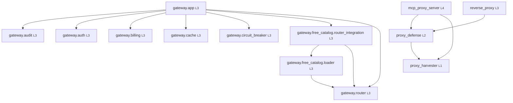

# Module Graph — as generated from the tree

> Generated by `scripts/gen-architecture.py`. Do not edit by hand;
> `python scripts/gen-architecture.py --check` fails CI when this is stale.

## Layers

| Layer | Name | Responsibility | Modules |
|-------|------|----------------|---------|
| 1 | **Supply** | harvested inventory, validation, trust scoring | `proxy_harvester` |
| 2 | **Egress core** | cache, dedupe, rate limit, pool, protocol ladder | `proxy_defense` |
| 3 | **Ingress** | optional HTTP entry points (reverse proxy, token plane) | `gateway.app`, `gateway.audit`, `gateway.auth`, `gateway.billing`, `gateway.cache`, `gateway.circuit_breaker`, `gateway.free_catalog.loader`, `gateway.free_catalog.router_integration`, `gateway.router`, `reverse_proxy` |
| 4 | **Agent surface** | MCP server + packaged skills | `mcp_proxy_server` |

## Import graph

### Edge notes

| From | To | Note |
|------|----|------|
| `gateway.app` | `gateway.audit` | redacted audit logger (lazy import in app) |
| `gateway.app` | `gateway.auth` | bearer-token dependency |
| `gateway.app` | `gateway.billing` | budget gate |
| `gateway.app` | `gateway.cache` | response cache |
| `gateway.app` | `gateway.circuit_breaker` | per-provider breaker |
| `gateway.app` | `gateway.free_catalog.router_integration` | tier-1 catalog wiring |
| `gateway.app` | `gateway.router` | model routing |
| `gateway.free_catalog.loader` | `gateway.router` | loader emits ModelRoute objects |
| `gateway.free_catalog.router_integration` | `gateway.free_catalog.loader` | vendored catalog |
| `gateway.free_catalog.router_integration` | `gateway.router` | wires catalog routes into the Router |
| `mcp_proxy_server` | `proxy_defense` | lazy import per tool call |
| `mcp_proxy_server` | `proxy_harvester` | honeypot + validate_proxy tools |
| `proxy_defense` | `proxy_harvester` | lazy import inside the pool; keeps cold import fast |
| `reverse_proxy` | `proxy_defense` | lazy import on first request |

## Layer direction check

All edges point downward or sideways. ✅

## Cycles

No import cycles. ✅

## Size

| Module | Lines |
|--------|-------|
| `gateway.app` | 406 |
| `gateway.audit` | 188 |
| `gateway.auth` | 65 |
| `gateway.billing` | 189 |
| `gateway.cache` | 136 |
| `gateway.circuit_breaker` | 117 |
| `gateway.free_catalog.loader` | 314 |
| `gateway.free_catalog.router_integration` | 89 |
| `gateway.router` | 255 |
| `mcp_proxy_server` | 972 |
| `proxy_defense` | 2301 |
| `proxy_harvester` | 933 |
| `reverse_proxy` | 1028 |

